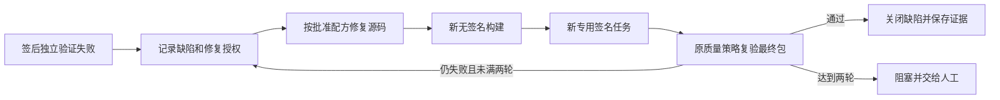

# Android 签名包的自动修复与复验

独立质量验证发现已签 Android 包不符合标准时，平台现在可以把修复提交继续送入无签名构建、专用签名和独立复验。每一步保留准确源码和制品来源，不会重用原签名意图。基础配置见 [Android 可信签名](android-signing.md)，受保护自动验证见 [质量调度](quality-scheduling.md)。

## 工作流程



签名程序失败或执行结果不明确，不属于质量失败修复。此时继续保留签名意图并阻塞，不能通过这条流程绕过原核对要求。开发 Agent 仍无权取得私钥、改变证书或降低质量策略。

## 前置条件

需求和方案必须已批准且保持当前版本。原方案需包含唯一可追溯的 developer/code 配方、具备 command/outputPath 的 unsigned 构建，以及 release/build 的 android-apk 或 android-aab 转换。Google Play 固定使用 android-aab，国内四渠道固定使用 android-apk，不能交换目标。签名目标和证书必须来自原批准方案。推荐 unsigned 任务直接依赖 code；签名任务依赖 unsigned，通过 inputArtifactFrom 指向该逻辑任务。

质量人员须事先通过 quality.bind 绑定受保护策略和验收标准，实际失败执行必须来自该策略对准确签后 package 的验证。单次人工 pipelines.run 的失败会留下缺陷并显示阻塞原因，不会自行授权新的源码修复和签名操作。自动修复不是发布批准。

工作区、构建、签名和质量节点延续原角色分离。签名节点只领取签名转换，不检出代码；无签名包不能获得最终质量证据或成为正式候选。

## 每轮保存什么

缺陷的 androidSigningRepairs 数组最多两项，记录每轮 ID、需求/方案/项目、原方案任务摘要、质量绑定、准确失败测试/执行/制品、原无签名构建与签名配方、证书、修复任务和配方摘要。它是受控制面的记录，不是调用方可提交的授权令牌。

修复成功后，continuation 保存准确修复 run、仓库和完整 commit，以及新 unsigned/signing/verification 任务及配方摘要。两轮都保留；第二轮从最新失败包的源码继续，而非第一轮或仓库默认分支。

生成任务的 signingRepairId 为保留字段，外部计划不能填写。签名输入仍按既有规则从成功依赖、准确字节和源码绑定推导。每次新任务产生新的 operationKey=sign-taskId，旧任务的意图、回执、包和结果都不修改。

原配方的命令、输出路径、角色、运行系统、目标和证书保持不变。生成任务的依赖按新修复链重建。配方摘要排除领取次数、原因、源码绑定/冲突、控制面恢复关联和实际推导的源码/质量调度字段；这些字段分别通过来源、租约、恢复证明及独立质量绑定检查，不能由调用方随意替换。

## 权限与变化

领取任务前检查当前需求/方案、原配方、质量策略和失败来源，再占用预算与领取次数。续租、源码/制品上传、完成以及签后包被用于新质量证据或发布时复查。撤销绑定、修改受保护命令、改变证书/配方/来源或破坏记录摘要都会拒绝，待领取任务留下阻塞原因。

受控修复任务拒绝通用 tasks.split 和 plans.reorder。需要改变修复方案、运行平台、证书或业务范围时，应由人批准新方案；不能修改权威记录或临时放宽策略。普通开发任务的拆分、重排和修复保持原行为。

目标预算、执行超时和重试上限继续生效。最多两轮是每个缺陷的自动业务修复上限，不是允许签名任务重试两次。任何签名未知结果都必须先核对原持久意图，tasks.retry 仍拒绝签名任务。

## 中断恢复

代码已通过受控快照保存、Worker 尚未确认完成时，保留原候选及租约状态。原租约失效后，负责人可使用既有 sources.reconcile 确认准确候选；平台记录 recovered 状态和人工决定，不伪造进程成功。当前修复授权仍有效且候选证明通过时，才能创建后续 unsigned/sign/recheck。策略已撤销时，确认操作不能继续派生任务。

平台数据库、仓库和制品的归档恢复保留修复记录与准确任务来源，不重新执行已确认的签名。管理员签名状态和密钥继续单独按企业制度备份；控制面备份不等于私钥灾备，也不能清除或接纳结果不明的签名意图。

## 本机真实验收

```sh
rtk proxy go run scripts/verify-trusted-android.go \
  --exercise-repair \
  --work-dir /private/qa/new-signing-repair \
  --signer-config-template /private/qa/temporary-test-signer.json \
  --serial emulator-5590 --avd Company_Repair_QA \
  --adb-server-port 15043 --android-sdk /private/android-sdk
```

与原签名验收入口相同，需新目录、管理员临时测试 profile、本机 work/run-native.py 工具包装、显式专用 AVD/ADB 和诊断包名。入口使用合成人审身份，固定命令引入 release-only 空标题提示错误；debug widget 测试仍通过，独立安装的 release UI 实际失败。失败截图、XML 和报告保留，再由同一已批准的确定性代码配方修复。平台重新编译 unsigned APK、用同一临时证书执行新的签名操作，并独立安装准确最终包复验。固定命令用例不证明模型自主推理或修复质量。

一次成功用例有8次真实 Worker 执行：初次 code/unsigned/sign/test、修复 code/unsigned/sign/test；其中首次 test 失败、其余成功。只有两个最终签名 package 获得自动调度，unsigned 不调度；最终只有一份通过证据，缺陷关闭。设备内 base.apk、平台最终制品、原始报告的 SHA256 相同，完整样本 Git 树139文件及模式可逐项读回。

该测试的 API 是 HTTPS 示例地址，只验证离线启动、刷新失败反馈和空标题校验，不启动业务后端。临时证书不是企业身份，模拟器不是 Android 真机；没有模型调用、正式商店或生产动作。实际 releases.create 仍应因缺 android-device 真机证据拒绝且不留下候选，完整产品/P3 保持开放。

Google Play AAB 的修复授权、并发领取、回执重放与归档恢复已有协议/数据库回归；本轮真实 AAB 验收为构建、签名和独立验证，没有模型修复。见 [AAB 手册](android-aab.md)。当前没有自动提升应用 versionCode、证书轮换、已发布客户端回滚或商店自动重提。用于已发布版本的新迭代仍须按原产品/发布流程批准版本和渠道动作。
