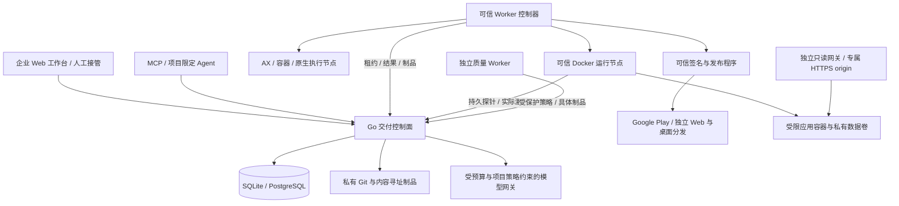

# 架构与权威状态

## 分层

控制面维护业务状态；AX 资源状态和 Agent 自述均不决定验收或交付。AX/Substrate 是 Linux 工具运行后端，可由容器或其他适配器替换。macOS、Windows 和设备执行各自注册节点，不通过 Linux 模拟“完成”原生交付。

is-publisher 的目的地与凭据由管理员固定，执行前验证批准制品，外部操作前保存日志。is-distribution 在独立 origin 提供只读 Web、不可变下载和签名索引，不读取控制面会话或私钥。等待渠道审核使用短查询任务，不持有长租约；观察结果不能替代独立质量证据。hosted Web 仅静态站点；后端通过独立 is-runtime 节点运行批准镜像，使用受限容器、内部网络、单写入者切换和只读网关。边界见 [运行手册](runtime.md)。

## 对象链

`project → goal / requirement → plan → task → run → artifact / evidence → approval → release / target`

已发布应用另有 `release / artifact → deployment → incident / rollback → new deployment / operational evidence`。回滚批准绑定准确当前版本与目标制品，成功产生全新激活；后续需求版本不取消已批准的运维恢复，也不使运行证据成为新需求验收。

所有对象具有 ID、种类、项目、目标、状态、版本、时间和类型数据。需求快照保存历史，知识修订产生新对象并链接前一版本；旧内容不会覆盖。重要对象关系用同一 SQL 事务验证并写入，成功和拒绝操作写入审计。Git 与制品在独立目录，数据库只保存可验证引用；SQL 与文件系统没有分布式事务，因此失败可能留下无引用对象，不能直接删除仍被引用的数据。

SQLite 适于单机开发；PostgreSQL 适于部署。当前数据库内全局事务锁串行化变更，优先保证正确性，尚未针对大型企业吞吐优化。Git/制品为本地卷，需要控制面节点共享一致数据；当前没有对象存储、分布式锁调优、跨地域复制或自动容灾。

## 人工决策与版本失效

组织权限链为 `identity → team / team_revision → project team_grant / team_grant_revision`。团队成员由企业管理员治理，项目负责人授权，当前角色为直接与启用团队角色的并集。权限派生、签发/撤销凭据、历史/请求键/审计共用事务锁；HTTP/Git/模型/任务共用当前检查，工作区的有效角色与来源仅为读取投影。每个项目仍须保留已注册且启用的直接负责人，团队所有权不替代恢复锚点。详见 [组织团队](organization-teams.md)。

- 项目产品/负责人确认需求基线，架构/负责人批准重大方案，发布角色/负责人批准正式候选。
- Agent 与 worker 主体即使拥有相同角色名称，也不能调用需要 human 主体的批准操作。
- 需求改变增加 revision，保存需求快照，取消研发活动执行，使计划、业务质量证据与发布候选失效。已运行应用的健康监测、批准回滚和独立运行证据继续保留。
- 方案替换使旧任务停止并要求相关候选重新绑定。发布绑定包括需求版本、计划、提交和全部必选目标制品摘要。
- 代码评审批准绑定当时的源提交及目标主分支；提交变化后旧评审无效。通过验证的提交只能快进合并，避免合并时产生未经验证的新提交。

## 执行与恢复

完整源码中断由 `source_commit / change → source_recovery → recovered run / succeeded task` 核对。负责人确认仍属原批准需求/方案的准确候选，检查实际分支包含关系，保留原作者，不修改 Git 或旧租约。下游重新验证决定链，修复任务恢复后仍重新构建与独立复测。见 [人工接管协议](source-recovery.md)。

任务状态：`pending → running → succeeded / failed / blocked`；取消为 `cancelled`，拆分父项为 `waiting`。节点每次最多领取一个任务，控制面验证能力、系统、身份、依赖、计划、预算和需求版本。租约 90 秒，可信控制器每 20 秒更新进度，续租不会超过任务截止时间。

code/build/security 的源码输入在创建租约前解析为固定提交及生产者记录，写入任务和执行快照。最近 code/build 依赖结果可以经设计任务或拆分父项传播；多输入须有包含全部选中历史的实际提交，未集成时持久阻塞。重试不改变绑定，已绑定任务不可拆分/重排；新结果必须符合当前 run、基础历史和制品 SHA。显式 sourceMode=integrate 的 code 任务可通过无检出 Git 准备树处理并行输入，当前租约记录精确冲突决定，最终多父快照经 CAS/SQL 确认后进入构建与独立质量。普通输入选择及重试见 [工作项源码输入](task-sources.md)，集成、权限和恢复见 [受控源码集成](source-integration.md)。

租约失效后，普通任务在尝试次数限制内重排队，发布任务必须核对。控制器对执行进程树实施取消；本机 native 模式要求显式启用，一定要运行在可丢弃、无敏感凭据的专用机器/虚拟机。

完成结果在节点本地保存后上报，完全相同的重放幂等，冲突结果被拒绝。失效租约的本地结果保存为 `.unresolved`，供人工核对，不重新执行已经可能发生的外部动作。调用方仍需保证完成记录所在卷可靠；这不是跨故障域复制队列。

## 动态协作与缺陷

批准方案定义初始工作图。Agent 可以拆分待执行的分析/设计/开发项，子项继承权限、系统、命令和总预算；可以调整待执行任务的依赖，控制面检查环路；所有调整附带原因与影响并形成独立记录。实际并行程度由匹配的已授权节点数量决定，Agent 无权注册更多高权限节点。

独立测试失败保留运行日志并创建缺陷。只有同一仓库的批准开发模板可作为修复来源；没有模板、缺少原始构建、预算不足或两轮修复后仍失败，则明确阻塞。修复提交触发原构建策略，并把新制品交给原受保护质量策略；独立复测通过后才关闭缺陷。

内部消息提供请求、进度、澄清、阻塞、结果、审查和取消意图；消息本身不能授予权限。发送校验收件身份、目标基线和因果来源。Worker 通过当前批准工作项的有效租约收件，消息与持久 message_receipt 在同一事务确认；记录绑定工作项、方案与需求版本，换节点重试可恢复，其他任务不能继承。单节点最多一个活动执行，recipientTaskId 还支持给后续工作项排队。人类/外部 Agent 的旧 claim/ack 保留三次领取上限，Worker 禁用旧接口。

模型每步调用前注入未见过的收件记录，完成前再次检查执行中到达的回复。记录表示进入任务上下文；收件后模型请求可能失败，完成前最后检查之后仍可能有迟到消息。分析/开发/设计可显式等待准确回复、释放节点并自动调度新执行；开发/设计保存独立的工作区 CAS 与原源码/集成绑定，恢复文件而不回放模型或命令。没有模型理解确认或原子“排空消息并完成任务”。单任务 32 条/64 KiB 超限时明确阻塞并保留未收消息。详见[协作收件](agent-inbox.md)和[工作区等待](workspace-waits.md)。控制面调度承担实际任务委派，当前没有 A2A 服务发现或跨企业 Agent 联邦。

## 质量证据的信任范围

首次独立验证采用 `quality_policy → quality_dispatch → task/run → evidence`。人类quality/owner固定批准需求、方案、标准及受保护策略快照；可信质量Worker轮询触发SQL事务内去重调度，仅消费成功构建执行的准确制品。领取、Worker取命令、完成和发布分别复核绑定与权限，策略变化或撤销阻止迟到结果。失败修复后的新制品关联新dispatch，并复用已有的原策略复测任务。活动策略快照进入候选批准，变更需重新创建候选。见[自动质量调度](quality-scheduling.md)。

质量策略由 human 质量角色定义，worker 领取后读取服务端策略，不能使用开发 Agent 提供的替代命令。质量身份不能兼任开发/发布。证据绑定需求版本、策略版本、执行节点、运行、具体提交、制品摘要、端和验收项。

`automated`、`simulator`、`device`、`manual` 分开记录。人工及设备验收需要独立验证人和同版本实际报告。除业务验收覆盖外，发布候选与发布后验证都强制检查实际目标环境：Web 为 browser，Windows/macOS 为对应系统，移动端为 ios-device/android-device 且必须 method=device。普通 CI、API 测试和模拟器不能满足这条门槛。平台核验绑定与内容完整性，不能凭空证明报告描述的物理动作发生；可信节点和独立验证人的操作制度仍是企业信任根。

## 发布状态

每个目标分别记录 `ready → submitting → processing → awaiting_review → awaiting_release / published → verified`，以及 `rejected`、`halted`、`reconciliation_required`。发布程序必须返回真实外部标识与状态；提审不算发布，发布不算独立验证。只有全部必选端处于 verified，整体 release/goal 才为 delivered。

外部不明结果只允许有权限的人显式核对。核对撤销相关旧运行和租约，防止延迟结果覆盖新结论；重新操作需要新幂等键。当前需求变更后的旧候选保留为 stale，不能再使用其批准发布，也没有单独实现历史渠道补录工作流；应在原渠道核对真实外部结果并记录运营事件，再批准新的候选。

## 凭据与平台边界

开发预览采用独立 listener/hostname，控制面只管理 `preview` 资源和短期 `preview` credential。资源固定需求、仓库、提交及制品；访问凭据绑定人工原会话，逐请求事务检查当前直接/团队权限，与普通 session/token 不互通，备份排除。独立静态网关先核对包摘要和限额，再用可信父页与 opaque sandbox iframe 提供静态体验；从原始包直接读取内存，不执行构建、不解压、不代理。停止、到期、需求变化和撤权不影响独立质量门禁。缓存与恢复边界见[开发预览](development-previews.md)。

密码 PBKDF2 哈希、会话/令牌只保存摘要；浏览器会话为 HttpOnly、SameSite、生产 Secure Cookie，并检查 Origin 与 CSRF。项目令牌不能成为人或管理员，worker 权限读取注册记录；关键资源修改要求匹配且未失效的 run lease。

模型密钥在控制面；平台令牌在可信 worker；签名、商店、生产密钥仅在可信发布程序。工具子进程得到最小环境，容器默认无网络、只读根文件系统、资源限制。不能因此将 native 执行称为沙箱。AX 管理面需独立网络/RBAC/atespace；不向客体注入控制面或模型密钥。

审计使用串联摘要检测意外修改；拥有数据库完全权限的人能够重写整条链，因此不等价于外部签章、WORM 存储或对管理员防篡改。当前没有细粒度字段级 DLP、企业密钥库、密码找回/MFA、分布式登录限流和完整身份生命周期集成。
