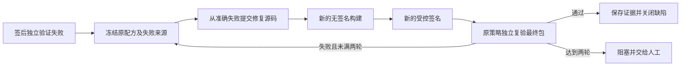

# Apple 与 Windows 签名包的修复与复验

独立质量验证拒绝已签 iOS IPA、macOS PKG 或 Windows MSIX 后，平台可在原批准范围内修复源码，重新无签名构建、执行新的受控签名，再由原独立质量策略验证最终包。质量中心的缺陷详情显示各阶段的实际任务状态和修复提交。

## 前置条件

原需求、方案保持有效且已批准。方案须有唯一可追溯的 developer/code 配方、developer/build 的 unsigned 配方和 release/build 的专用签名转换。三者的依赖和源码来源可追溯，构建包含批准的 command/outputPath；签名任务不能包含仓库命令或自行选择凭据。

质量负责人须事先通过 `quality.bind` 绑定原策略、目标和验收标准。失败执行必须来自该策略对准确最终签名包的验证。单次 `pipelines.run` 不能自行授权修复与新签名；失败仍会保留缺陷并说明阻塞原因。

| 目标 | 签名模式 | 必须保持的身份 |
|---|---|---|
| iOS App Store | `ios-ipa` | Distribution 证书 SHA256、Apple team、provisioning profile SHA256 |
| macOS | `macos-pkg` | Installer 与 Application 两份证书 SHA256、Developer ID team |
| Windows | `windows-msix` | 证书 DER SHA256、Publisher、包名、四段版本 |

原生执行节点、私有 CLI 和企业身份的配置分别见 [iOS](ios-signing.md)、[macOS](macos-signing.md)、[Windows](windows-signing.md)。新签名没有新的发布授权。若需更换身份、提升已发布应用版本或改变业务范围，应批准新方案。

## 正常与失败流程



macOS 公证处理中，平台保存原操作、释放租约并等待下一次状态查询；只有已完成并装订票据的最终 PKG 才进入独立复验。新修复签名从新的 sign 操作开始，不继承原公证 ID、阶段、查询次数、截止、活动耗时或固定节点；原任务的历史保持。新任务遵循自己的24小时等待截止、查询上限和活动执行预算。

签名 CLI 崩溃、超时、租约丢失或结果不明确会阻塞原签名任务。这属于未确认操作，不能通过质量修复产生替代签名。`tasks.retry` 仍拒绝受控签名；先按管理员手册核对原持久意图。开发 Agent 无权读取私钥、修改强制质量标准或批准正式发布。

## 持久记录与兼容性

新 native 缺陷使用 `defect.data.signingRepairs`，每项 `version=2`，最多两轮。原 Android 的 `androidSigningRepairs`、`version=1` 和摘要算法保持兼容，不需数据迁移；同一缺陷不能混用两个记录数组。

每轮记录项目、目标、需求/方案版本及方案任务摘要、质量绑定与摘要、准确失败 test/run/artifact、原 unsigned/sign 配方、批准签名身份、修复任务与配方摘要。`continuation` 记录可信修复 run、仓库、完整提交和新 unsigned/sign/verification 任务及配方摘要。第二轮必须来自上一轮失败包。`signingRepairId` 是控制面保留字段，外部计划不能声明。

领取前以及续租、源码与制品上传、完成、源码恢复、最终签名包用于新证据或候选时均复查授权。撤销策略、需求/方案变化、配方或身份漂移、来源改变、记录破坏会阻止继续执行；领取前失败不消耗执行次数。受控修复链不能通过 `tasks.split` 或 `plans.reorder` 改写。

macOS 持久公证观察不进入不可变配方摘要，继续由签名输入、原操作回执和私有签名服务核对。排除观察字段不允许改证书、团队、目标、命令、依赖或超时预算。每轮 `operationKey=sign-taskId` 都不同，旧任务、包、意图与回执保持。

## 人工接管与恢复

在“质量与证据”打开缺陷，检查当前阶段、阻塞原因、失败制品、准确修复提交和关联工作项。工作区源码已保存但完成未确认时，沿用 `sources.reconcile` 人工核对原候选；授权仍有效才派生后续构建。该操作记录 recovered，不伪造原进程成功。达到两轮后由人调整方案，不删除历史记录重新计数。

控制面备份保存修复记录、仓库、任务和制品；恢复后复查准确摘要，已完成签名只读重放，不重新执行。控制面备份不等于签名节点私有状态和密钥灾备；原生 CLI 的私有意图、企业凭据仍由管理员单独备份与核对。

## 验证方式与当前边界

```sh
rtk proxy go test ./internal/platform -run 'TestNativeSigningRepair' -count=1
rtk proxy go test ./internal/worker -run 'TestWorkerNativeSigningRepair' -count=1
rtk proxy python3 scripts/verify-workbench.py --suite native-signing-repair
```

PostgreSQL 并发和恢复用例需将 `IS_TEST_POSTGRES_URL` 指向隔离数据库，再运行 `TestPostgresNativeSigningRepairLeaseReplayAndRestore`。设置 `IS_SIGNING_REPAIR_EVIDENCE_DIR` 为已存在的私有新目录，可保存 Worker/数据库测试的原始资源、制品、固定 signer 请求和备份。每个证据子目录须不存在，不覆盖已有记录。

完整 race 回归使用 `rtk proxy go test -race -count=1 -timeout=20m ./...`，与 `make check`、CI 和 README 的20分钟单包时限一致。新增安全边界场景使平台包可能超过 Go 默认10分钟；保留超时失败日志，再完整重跑，不以部分通过代替最终结果。远程 CI 状态以实际运行结果为准。

控制面测试验证三端授权和状态机；本机 macOS 的真实 HTTP/Git/Worker/子进程检验固定代码先失败后修复及最终准确字节。签名成功回执、包和公证结果明确使用替身，CI 验证不构成原生应用、合法企业签名、真机安装、App Store 或 Windows 正式交付。Windows Worker 的原生系统检查保持，未在 macOS 上绕过运行。模型未参与这些确定性修复测试。

正式交付仍需目标设备/系统业务验收、合法签名身份、发布批准、渠道实际发布和上线验证。完整产品 P3 保持开放。

<!-- intelligence-substrate-native-signing-repair-runbook-end -->
